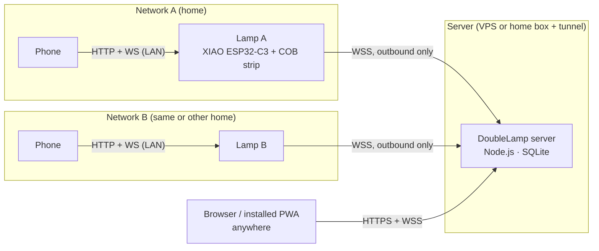
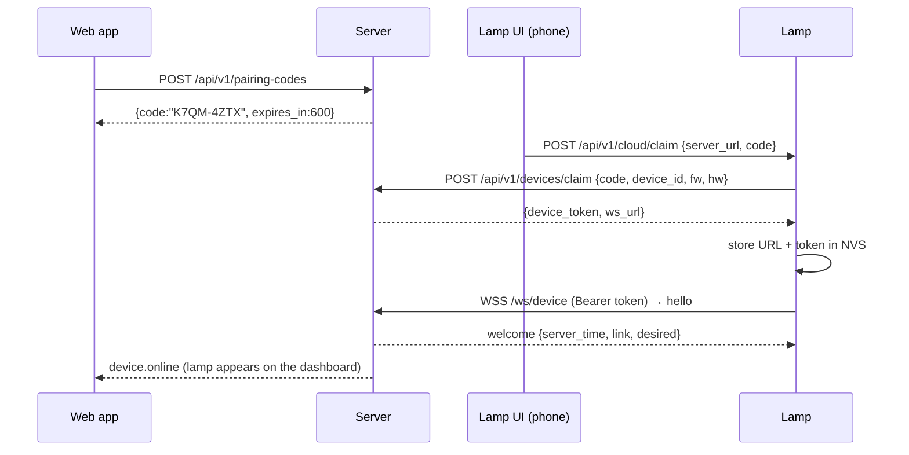
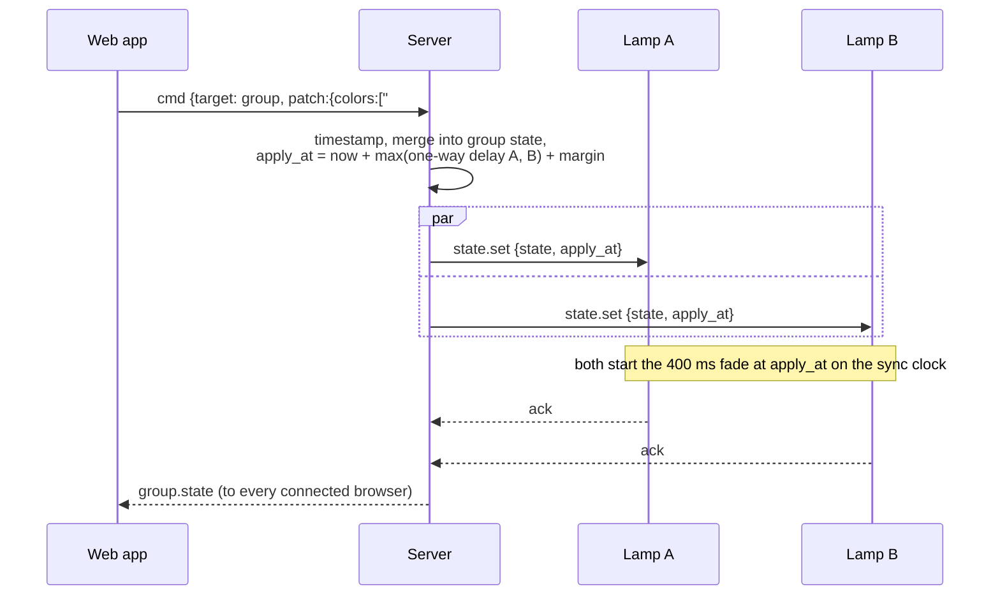
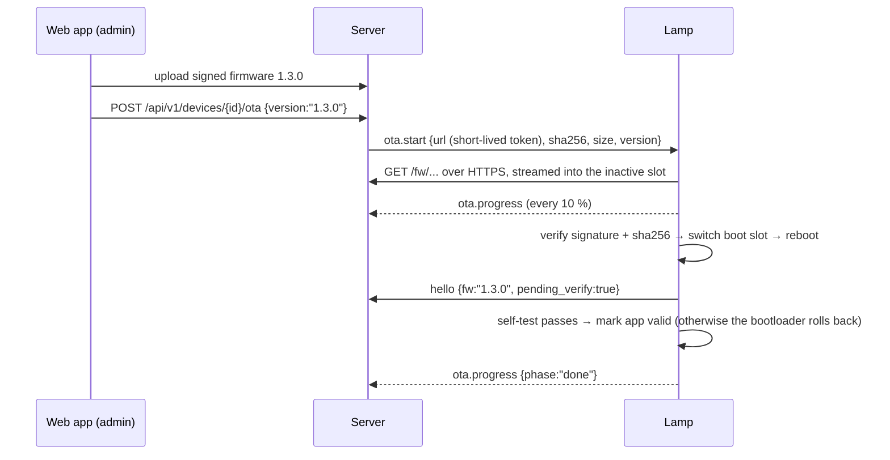

# 01: System Architecture

## 1. System context



Each lamp owns its own state. The server is an optional coordinator. When the lamps are linked, the server is the point where all changes are put in order ([ADR-0003](adr/0003-time-synced-state-replication.md)).

## 2. Components

| Component | Runs on | Responsibility |
|---|---|---|
| **Firmware** (`firmware/`) | XIAO ESP32-C3 | Drives the strip, holds the lamp's state, serves the local UI and API, keeps a WSS link to the server, handles OTA |
| **Device UI** (`device-ui/`) | Phone browser, served by the lamp | Setup wizard and local control. Embedded in the firmware image and works with no internet. |
| **Server** (`server/`) | Linux host / Docker | Auth, lamp pairing, link groups, sync engine, scenes, schedules, firmware hosting |
| **Web app** (`web/`) | Browser / PWA, served by the server | Controls and syncs both lamps from anywhere |
| **Protocol package** (`packages/protocol/`) | Build time | Message types, zod schemas and JSON test vectors shared by server, web app and firmware tests |
| **Effects package** (`packages/effects/`) | Browser | TypeScript port of the firmware effects for live previews. Tested against the same golden frames as the firmware. |
| **Virtual lamp** (`tools/virtual-lamp/`) | Dev machine / CI | Simulated lamp that speaks the device protocol, for server and web development without hardware |

## 3. Control paths

Every input ends up as a command on the lamp's single state task ([03 §4](03-firmware.md#4-state-store)). Inputs include the local API, the server link, the button and internal timers.

| Path | Route | Used for |
|---|---|---|
| **Local LAN** | Phone → `http://doublelamp-xxxxxx.local` or the lamp's IP | Everyday control at home. Lowest latency (< 150 ms). |
| **Direct AP** | Phone joins the lamp's access point → `http://192.168.4.1` | First-time setup. Fallback when home WiFi is down. Places with no WiFi. |
| **Server** | Browser → server → lamp | Control from anywhere, linking the two lamps, scenes, schedules, OTA |

What still works in each situation:

| Situation | Phone on same network | Phone elsewhere | Linked sync |
|---|---|---|---|
| Everything up | ✅ local and server | ✅ server | ✅ |
| Internet or server down | ✅ local | ❌ | ❌ Each lamp keeps its state and catches up on reconnect. |
| Home WiFi down | ✅ through the lamp's fallback AP | ❌ | ❌ |
| Network blocks devices from talking to each other (dorm/hotel) | ❌ LAN access is blocked | ✅ server | ✅ |

The last row is a big reason the server path matters: many shared networks stop devices on the same network from talking to each other.

## 4. Deployment options

| Option | Server location | Lamps | Notes |
|---|---|---|---|
| **T1 Standalone** | none | anywhere | Local control only. No linking. |
| **T2 Home LAN** | Raspberry Pi or PC on the same LAN | same LAN | No public exposure. Linking works at home only. |
| **T3 Public (recommended)** | Small VPS with a domain, or a home box behind Cloudflare Tunnel / Tailscale Funnel | anywhere | Required when the lamps are in different homes. TLS from Caddy (Let's Encrypt). |

## 5. Key flows

### F1: First-time setup (captive portal)

```mermaid
sequenceDiagram
  participant P as Phone
  participant L as Lamp (setup AP)
  Note over L: no WiFi credentials → open AP "DoubleLamp-3FA2C1"<br/>strip breathes blue
  P->>L: join AP; OS sends captive-portal probe
  L-->>P: 302 → http://192.168.4.1/setup
  P->>L: GET /api/v1/wifi/scan
  P->>L: POST /api/v1/setup {ssid, password, name, admin_password, power, [server_url, pairing_code]}
  Note over L: AP+STA: the AP stays up while the station connects
  loop every 1 s
    P->>L: GET /api/v1/setup/status
  end
  L-->>P: {state:"online", ip:"192.168.1.57", host:"doublelamp-3fa2c1.local"}
  Note over P: page shows the new address and an "Open lamp" link
  L->>L: two green blinks; AP closes after 60 s
```

### F2: Adding a lamp to the server (pairing)



The code can also be entered in the setup wizard (F1), so a new lamp joins WiFi and the server in one pass.

### F3: Linked change from the web app



### F4: Change on lamp A's own UI while linked

```mermaid
sequenceDiagram
  participant P as Phone (LAN)
  participant A as Lamp A
  participant S as Server
  participant B as Lamp B
  P->>A: PATCH /api/v1/state {brightness:60}
  A->>A: apply immediately so local control feels instant
  A->>S: state.report {patch, origin:"local"}
  S->>S: timestamp, merge into group
  S->>B: state.set {state, apply_at}
  S->>A: state.set {state} (echo; no visible change if equal)
```

Lamp B follows about one round trip later. Echoing to every member, including the sender, makes all lamps settle on the same state even when two changes race.

### F5: Reconnect after being offline

```mermaid
sequenceDiagram
  participant A as Lamp A
  participant S as Server
  participant B as Lamp B
  Note over A: offline for 20 min; colors changed locally 5 min ago
  A->>S: hello {state, dirty:{colors:{age_ms:300000}}}
  S->>S: per field: lamp_ts = now − age_ms vs. server field ts → newer wins<br/>fields with no age (unknown) → server wins
  S-->>A: welcome {desired: merged state}
  S->>B: state.set (only if linked and lamp A's edit won)
```

Lamps report the *age* of offline edits, measured on their monotonic clock, instead of a wall-clock time. This stays correct even when a lamp had no internet time while offline ([04 §6](04-protocol.md#6-merge-rules)).

### F6: OTA update



## 6. Repository layout

```
doublelamp/
├─ docs/                     these documents
├─ firmware/                 ESP-IDF project (C++17)
│  ├─ main/                  app_main: wires components together
│  ├─ components/
│  │  ├─ lamp_core/          state store, merge, presets (pure C++, host-testable)
│  │  ├─ effects/            effect functions (pure C++, fixed-point, host-testable)
│  │  ├─ led_output/         render task + pipeline + led_strip driver
│  │  ├─ net/                WiFi, setup AP, captive DNS, mDNS, SNTP
│  │  ├─ local_api/          esp_http_server routes + WebSocket
│  │  ├─ cloud_link/         WSS client, time sync, OTA jobs
│  │  ├─ storage/            NVS wrapper, delayed state writes
│  │  └─ device_ui/          embedded index.html.gz (built from /device-ui)
│  ├─ test/host/             host unit tests for lamp_core, effects, protocol
│  ├─ partitions.csv
│  └─ sdkconfig.defaults
├─ device-ui/                lamp UI: TypeScript, no framework → one gzipped HTML file
├─ server/                   Node.js + TypeScript (Fastify, ws, SQLite)
├─ web/                      React + Vite + TypeScript PWA
├─ packages/
│  ├─ protocol/              types, zod schemas, test-vectors/*.json
│  └─ effects/               TS effects + golden-frame tests
└─ tools/
   ├─ virtual-lamp/          simulated lamp (Node) with a terminal/browser preview
   └─ sign-firmware/         signing + upload helper
```

The TypeScript parts are one pnpm workspace. The firmware builds separately with `idf.py`.

## 7. Technology choices

| Layer | Choice | Reason |
|---|---|---|
| Firmware | ESP-IDF v5.x, C++17, FreeRTOS | Espressif-maintained parts for every need: LED driver, HTTP+WS server, WS client, OTA with rollback, signed images ([ADR-0001](adr/0001-esp-idf-firmware.md)) |
| LED driver | `espressif/led_strip`, **SPI backend with DMA** | WiFi interrupts can't break WS2812 timing. The C3's RMT peripheral has no DMA ([03 §5](03-firmware.md#5-led-output-pipeline)). |
| Lamp ↔ server | WebSocket over TLS, JSON | Port 443 only, so it works through proxies and tunnels. Same transport as the browsers ([ADR-0002](adr/0002-websocket-transport.md)). |
| Sync model | Server-ordered state + `apply_at` + time-based effects | Phase-locked lamps without streaming frames ([ADR-0003](adr/0003-time-synced-state-replication.md)) |
| Server | Node.js LTS, TypeScript, Fastify, `ws`, SQLite (better-sqlite3 + Drizzle), pino | Types shared with the web app. A one-file database with nothing to operate. |
| Web app | React + Vite + TypeScript, Zustand, react-colorful, PWA | Common and well documented. Small runtime. |
| Device UI | Plain TypeScript + esbuild → single gzipped HTML (≤ 60 KB) | Has to work offline on the lamp's AP and inside the phone's captive-portal browser |
| Deployment | Docker Compose: server + Caddy (automatic HTTPS) | One command to run. Certificates renew themselves. |
| CI | GitHub Actions: ESP-IDF container build + host tests; pnpm lint/test/build | |

## 8. Cross-cutting conventions

- **Identity.** `device_id = "dl-" + last 3 MAC bytes in hex`, e.g. `dl-3fa2c1`. The mDNS host is `doublelamp-3fa2c1`. The AP SSID is `DoubleLamp-3FA2C1`.
- **Time.** All timestamps are Unix milliseconds on the sync clock. All durations are milliseconds.
- **Versioning.** Firmware uses SemVer (`1.3.0`). The protocol has an integer version, `proto: 1`. The server accepts `proto` N and N−1, and all parties ignore unknown fields.
- **Logging.** Lamps log to USB serial and to a 4 KB RAM ring buffer, readable by admins at `/api/v1/logs`. Warnings and errors are also forwarded to the server. The server writes JSON logs with pino.
