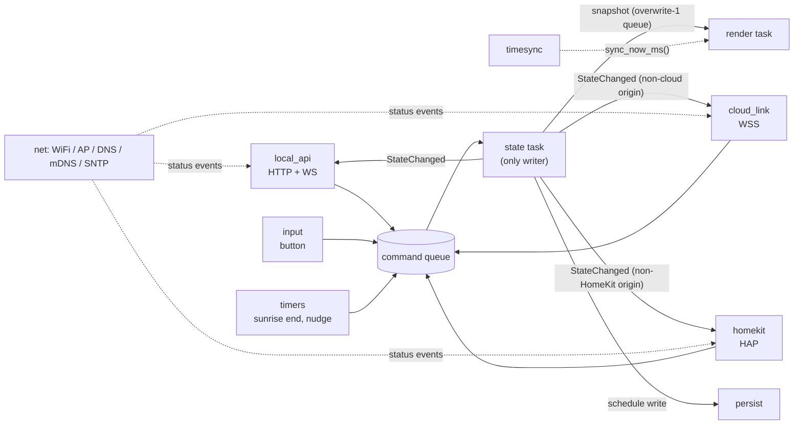
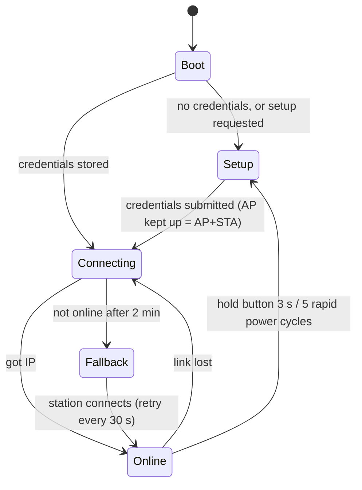

# 03: Firmware

## 1. Overview and constraints

The firmware turns one XIAO ESP32-C3 into a lamp that:

- turns its light back on within about 0.5 s of power-up, before WiFi has even started;
- can be controlled locally with no server, from its own web UI or from Apple Home;
- keeps an optional link to the server for linking, scenes, schedules and OTA.

These hardware facts drive most of the decisions below:

| Constraint | Consequence |
|---|---|
| Single core, 160 MHz | Task priorities alone decide smoothness. Rendering must be cheap and must never wait on network or flash. |
| No FPU | Effects use integer and fixed-point math only: Q16 numbers, a sine lookup table, integer HSV. |
| RMT peripheral has no DMA on the C3 | WS2812 timing is generated by **SPI + DMA**, so WiFi interrupts can't corrupt it (§5). |
| About 400 KB SRAM, shared with WiFi, TLS and HomeKit | At most 3 local WebSocket clients, 4 HomeKit sessions and 1 TLS session. Fixed buffers, no per-frame allocation. |
| 4 MB flash | Two OTA slots of 1.875 MB each, holding the app, the embedded UI and the HomeKit stack. There is no separate filesystem partition (§15). |

## 2. Framework and dependencies

- **ESP-IDF v5.x**, version pinned in CI. Code is C++17 with exceptions and RTTI turned off. See [ADR-0001](adr/0001-esp-idf-firmware.md).
- Packages from the IDF Component Manager, with versions pinned in `idf_component.yml`:
  - `espressif/led_strip` for the SPI and RMT LED backends
  - `espressif/mdns`
  - `espressif/esp_websocket_client`
  - cJSON
- **`espressif/esp-homekit-sdk`**, the open-source (non-MFi) variant, pinned as a git submodule under `firmware/third_party/` (§11).
- Built-in IDF parts: `esp_http_server` (with WebSocket support), `esp_https_ota`, `nvs_flash`, `esp_netif`/`esp_wifi`, `esp_sntp`, `esp_crt_bundle` and the bootloader's app rollback.
- **Pure-logic components** (`lamp_core`, `effects`, protocol encode/decode) include no IDF headers. They compile on the host for unit tests ([08](08-testing-and-roadmap.md)).

## 3. Tasks and priorities



| Task | Priority | Stack | Runs when | Notes |
|---|---|---|---|---|
| WiFi / lwIP (IDF) | 23 / 18 | IDF default | n/a | Left above everything else |
| `render` | 15 | 4 KB | every frame (`vTaskDelayUntil`) | ~1–3 ms of CPU per frame at 300 px. Never blocks on anything but the LED transfer. |
| `state` | 12 | 4 KB | a command is queued | The only writer of `LampState` |
| `input` | 7 | 3 KB | every 10 ms | Button polling and gestures (§14) |
| `cloud` | 6 | 6 KB | messages arrive, plus a 1 s tick | Protocol logic, time sync, OTA control |
| `httpd` (IDF) | 5 | 8 KB | requests arrive | Local API. Sends to WS clients via `httpd_queue_work`. Pairing calls and local OTA uploads block it briefly. |
| HAP server (HomeKit SDK) | 5 | 12 KB (SDK default; trim after measuring) | iPhone requests | Pairing math (SRP, several seconds of CPU once per iPhone) runs *below* render (§11) |
| WS client (IDF) | 5 | 7 KB | socket events | The TLS handshake (~1 s of CPU) runs *below* render, so animations don't stutter |
| `setup`, `dns` | 5, 4 | 6 KB, 3 KB | setup mode only | Setup orchestration (§8) and the captive DNS server |
| `ota` | 4 | 8 KB | on demand | Streams HTTPS into the inactive slot |
| `persist` | 3 | 3 KB | 5 s after the last change | NVS writes |

`CONFIG_FREERTOS_HZ=1000`, so frame timing has 1 ms resolution.

## 4. State store

`lamp_core` follows an actor model. Every input becomes a `Command` on one FreeRTOS queue (depth 16), and the `state` task applies commands in order. Because of this, nothing else takes locks on the state.

```cpp
struct Effect   { EffectId id; uint8_t speed, intensity; uint32_t seed; int64_t epoch_ms; uint32_t duration_ms; };
struct LampState {
  bool     on;
  uint8_t  brightness;          // 0–255, perceptual (curve applied at output)
  RGB8     colors[3]; uint8_t ncolors;
  Effect   effect;
  uint32_t rev;                 // +1 on every applied change
};
enum class Origin : uint8_t { Local, Cloud, HomeKit, Button, Timer, Boot };
struct Patch { FieldMask fields; LampState values; uint16_t transition_ms; int64_t apply_at; Origin origin; };
```

Steps for each command:

1. **Validate and clamp.** Ranges are in [04 §2](04-protocol.md#2-data-model). Unknown effect ids are rejected with an error and leave the state untouched.
2. **Merge** the patch fields into the state. If `effect.id` changed and the patch has no epoch, set `effect.epoch_ms = max(sync_now, apply_at)`.
3. **Track each field.** For every changed field, record `changed_at_mono` (from `esp_timer`). If the server is disconnected, also set `dirty[field]`. This is what powers the reconnect merge ([04 §6](04-protocol.md#6-merge-rules)).
4. **Increment `rev`** and publish `StateChanged {rev, state, fields, origin, transition_ms, apply_at}` to the subscribers:

| Subscriber | What it does |
|---|---|
| `render` | Gets the snapshot through an overwrite-1 queue. Only the newest snapshot matters. |
| `local_api` | Sends the state to all local WS clients |
| `cloud_link` | Sends a `state.report` unless `origin == Cloud`. Not echoing server changes back prevents loops. |
| `homekit` | Updates the HAP characteristics that changed, unless `origin == HomeKit`, so paired iPhones see the new state (§11) |
| `persist` | Schedules an NVS write |

`apply_at` only delays the *visible* change. The logical state updates immediately, and the render task starts the transition at `apply_at` (§5).

**Other commands:**
- `ApplyPreset(n)` and `Toggle` turn into patches.
- `Identify(ms)` and `Nudge(color, count)` become render **overlays**. Overlays are shown briefly and never change or save the state.
- `SetConfig(...)` updates the LED config. A change to `pixel_count` or `color_order` re-creates the LED driver without rebooting.

## 5. LED output pipeline

The render task runs every `1000 / fps` ms. Default `fps` is 50; the maximum is 100.

```
 snapshot ─► transition planner ─► effect.render() ─► crossfade ─► brightness ─► linearize
           (start at max(now, apply_at))                 (from frozen last frame)   + color correction
                                                                                    │
 led_strip SPI-DMA ◄─ color order / RGBW ◄─ dither 16→8 bit ◄─ current limiter ◄────┘
```

1. **Time.** `t = sync_now_ms()` ([§12](#12-time-sync)).
2. **Transition planning.** When a new snapshot arrives, freeze the last output frame as `from`. Then schedule a crossfade from `max(now, apply_at)` lasting `transition_ms`, with smoothstep easing. Brightness and power fade on their own timer, so dragging the brightness slider doesn't restart the color crossfade. Turning the lamp off is a fade to 0, and the rest of the state is kept.
3. **Effect.** `effect.render(params, t − epoch, n, out)` writes sRGB 8-bit pixels (§6).
4. **Crossfade.** Blend `from` and `out` in 8-bit sRGB.
5. **Brightness.** Map the 0–255 perceptual brightness through the CIE L\* curve to a 16-bit scale.
6. **Linearize and correct.** Convert sRGB to linear with a 256 → 16-bit lookup table (≈ γ 2.2). This makes colors match the picker on screen. Then apply the per-channel `color_correction` scale, because many COB whites look bluish.
7. **Current limiter.**
   - Estimate current: `est_mA = idle_mA + Σ(r+g+b)/(3·65535) · ma_per_pixel_white`.
   - If `est_mA > max_current_ma`, scale the frame by `k = max/est`.
   - `k` moves toward its target with a time constant of about 200 ms, so brightness doesn't pump.
8. **Dithering.** Temporal error-diffusion from 16 to 8 bits, per pixel and channel. It's on by default and switches off automatically below 60 fps. It smooths very dim fades, where 8-bit steps are visible.
9. **Output format.** Reorder the channels to `color_order`. For RGBW strips, extract white as `w = min(r,g,b)` and subtract it from r, g and b.
10. **Send.** `led_strip_refresh()` on SPI2 with DMA, with MOSI routed to GPIO7. The CPU is free during the DMA transfer. The task then waits for the next frame.

**Why SPI and not RMT.** The C3's RMT peripheral has no DMA. Feeding WS2812 data through RMT needs a buffer refill every ~30–60 µs, and WiFi interrupts can be late by more than that. The result is underruns, which show up as wrong colors further down the strip. The SPI backend encodes each WS bit as 3 SPI bits at about 2.5 MHz and streams the whole frame by DMA. RMT is kept as a Kconfig option (`LAMP_LED_BACKEND_RMT`), using an ISR in IRAM and the largest memory block.

**Throughput.** Each pixel takes about 30 µs, plus a reset gap of over 280 µs.

| Pixels | Transfer time | Frame rate |
|---|---|---|
| 10 (one lamp in this build, [02 §3](02-hardware.md#3-the-strip)) | 0.6 ms | 100 fps |
| 80 (a full 5 m reel of the chosen strip) | 2.7 ms | 100 fps |
| 300 | 9.3 ms | 50–100 fps |
| 600 | 18.3 ms | 50 fps |
| 1024 | 31 ms | ≈ 30 fps (automatic) |

The task picks `fps = min(configured, 1000 / (tx_ms + render_ms + 2))`.

**WS2811 timing.** The chosen strip's WS2811 runs at 800 kHz and accepts WS2812 bit timing. Use the driver's WS2811 model if the pinned `led_strip` version has one, and confirm with the glitch test ([02 §7](02-hardware.md#7-bring-up-checklist)).

**Memory at n pixels.** 3n each for `from` and `out`, 6n for 16-bit working data, 3n for dither error, and about 9n of DMA buffer. That's ≈ 24n bytes, or about 24 KB at 1024 pixels. Everything is allocated when the config is applied, never per frame.

## 6. Effects

The interface is in `components/effects`. The same functions are ported 1:1 to `packages/effects` in TypeScript.

```cpp
struct EffectParams { uint8_t speed, intensity; const RGB8* colors; uint8_t ncolors; uint32_t seed; uint32_t duration_ms; };
struct EffectDesc {
  const char* id; const char* name; uint16_t uses;   // bit flags: COLORS1..3, SPEED, INTENSITY, DURATION
  void (*render)(const EffectParams&, uint64_t t_ms, uint16_t n, RGB8* out);
};
```

**Rules.** These keep the two lamps and the web preview identical:

1. **Pure functions.** Output depends only on `(params, t, i, n)`. No static state, no frame counters, no `esp_random()`.
2. **Repeatable randomness.** Use a counter-based hash, `h = hash32(seed, i, t / step)` (32-bit integer mixing). Two lamps with the same seed and clock then produce the same "random" output.
3. **Normalized position.** Use `x = (2i + 1) · 65536 / (2n)` (Q16). Lamps with different pixel counts then look the same.
4. **Integer math only.** Use `sin16`, `ease8` and `hsv2rgb8` lookup tables and fixed-point arithmetic. The TypeScript port uses `Math.imul` and `| 0` for bit-exact results.
5. **Bounded time.** Take `t % period` in 64-bit before narrowing it.
6. **Budget.** Rendering 300 px must take ≤ 2 ms at 160 MHz. A host benchmark plus an on-device timing log enforce this.

**Tuned for 10 pixels.** Each lamp in this build has only 10 pixels ([02 §3](02-hardware.md#3-the-strip)). Defaults are chosen so effects still read well: `twinkle` density defaults low, and `rainbow`'s default hue span is less than one full rainbow per lamp. The golden vectors include `n = 10`.

**v1 effects**

| id | Name | Uses | Behavior |
|---|---|---|---|
| `solid` | Solid | colors[0] | Static color |
| `breathe` | Breathe | colors[0], speed (period 2–20 s), intensity (depth) | Sinusoidal brightness |
| `gradient` | Gradient | colors[0..2], speed (drift, 0 = static) | Blend along the strip |
| `cycle` | Color cycle | speed, intensity (saturation) | Whole strip rotates through hues |
| `rainbow` | Rainbow | speed, intensity (hue span) | Rainbow moving along the strip |
| `candle` | Candle | colors[0], intensity (flicker depth), seed | Repeatable noise flicker |
| `twinkle` | Twinkle | colors, speed, intensity (density), seed | Random pixels fade in and out |
| `sunrise` | Sunrise | duration (5–60 min) | Runs once: deep red → amber → warm white, then holds as `solid` |
| `sync_test` | Sync test | n/a | Full white for 20 ms at each whole second of the sync clock, for measuring skew between lamps ([08](08-testing-and-roadmap.md)) |

**Overlays.** These are not part of the state. They are blended over the output for a limited time:

| Overlay | Look | Trigger |
|---|---|---|
| `identify` | 3 white blinks | Identify command |
| `nudge` | 3 soft pulses in a given color | Nudge command |
| Status patterns | See §14 | Lamp status |

Overlays are capped at 25 % brightness unless the lamp is on.

## 7. Networking



| State | Access point | Station | What's running |
|---|---|---|---|
| **Setup** | Open AP `DoubleLamp-XXXXXX`, captive DNS | off, or connecting | Setup wizard. Setup endpoints need no auth. |
| **Connecting** | off, or kept up after setup | backoff 1 s → 30 s with jitter | Render and local API (only on the AP, if it's up) |
| **Online** | off. Stays on if "direct mode always on" is set. | connected | Local API, mDNS, SNTP, HomeKit, cloud link |
| **Fallback** | WPA2 AP `DoubleLamp-XXXXXX` using the direct-mode password | retrying every 30 s | Local API over the AP. Control works with no router. No HomeKit. |

**Details:**
- **Power save off.** WiFi runs with `WIFI_PS_NONE`. The lamp is mains-powered, and modem sleep would add 100–300 ms of latency.
- **mDNS.** Host `doublelamp-xxxxxx.local`. Services `_http._tcp:80` and `_doublelamp._tcp:80`, with TXT records `id`, `name`, `fw`, `proto`. The HomeKit SDK adds `_hap._tcp` on its own port (§11) through the same mDNS instance. Android's support for `.local` names is patchy, so the setup "done" page and the server dashboard also show the lamp's IP.
- **SNTP.** Uses `pool.ntp.org` (configurable). It provides wall-clock time for logs, TLS certificate validity and later on-device schedules.
- **WPA2-Enterprise** (stretch goal). PEAP/TTLS through `esp_eap_client`, with identity, username and password fields in setup, plus an optional CA certificate upload.
- **Not supported:** networks that need a web login page. Use a phone hotspot or a separate IoT network instead.

## 8. Setup and captive portal

1. **No credentials.** The lamp starts an open AP, plus a DNS server on UDP 53 that answers every name with `192.168.4.1`. The strip breathes blue.
2. **Captive-portal probes** get a `302` redirect to `/setup`, so phones open the wizard by themselves:

   | Probe path | Sent by |
   |---|---|
   | `/generate_204` | Android |
   | `/hotspot-detect.html` | Apple |
   | `/connecttest.txt`, `/ncsi.txt` | Windows |
   | anything else | Any client |

3. **The wizard** ([06 §B](06-web-apps.md#part-b-device-ui)) asks for:
   - WiFi network and password
   - lamp name
   - admin password (min 8 characters; it also becomes the default direct-mode password)
   - strip length, which sets `pixel_count` (16 per meter, [02 §3](02-hardware.md#3-the-strip)), and power supply
   - optional server URL and pairing code
4. **On submit,** the lamp switches to **AP+STA** and connects while the AP stays up. The phone polls `/api/v1/setup/status` and is shown either the result or the specific error (wrong password, network not found, no IP).
5. **On success,** the lamp saves everything to NVS, blinks green twice, and claims itself on the server if a code was given. It keeps the AP up for 60 s so the phone can show the new address and the Apple Home setup code (§11), then shuts it down.

Phone captive-portal browsers (iOS in particular) may not keep `localStorage` and close when the network changes. So the wizard keeps its progress on the lamp and never depends on browser storage.

## 9. Local API server

- **Server.** `esp_http_server` on port 80. Routes are in [04 §3](04-protocol.md#3-lamp-local-api).
  - `max_open_sockets = 5`, with LRU purge enabled. This leaves room in the socket budget for the HomeKit server (§17).
  - At most **3 WebSocket clients** on `/api/v1/ws`. A 4th connection gets close code `1013 try again later`.
  - `esp_http_server` answers the WebSocket handshake itself and doesn't call the URI handler for it. So the `Host` and `Origin` checks run in its pre-handshake callback, and the client limit and the first `state` and `info` messages run in its post-handshake callback (both enabled in §17).
- **UI.** A single `index.html.gz` is embedded with `EMBED_FILES`. It's served with `Content-Encoding: gzip`, `Cache-Control: no-cache` and `ETag` set to the firmware build id. Since the UI ships inside the firmware, every OTA updates both together.
- **Pushes.** State and info updates go out as WS text frames through `httpd_queue_work` → `httpd_ws_send_frame_async`. If a client's send fails twice, it's dropped.
- **Request guards.** Details are in [07 §4](07-security.md#4-lamp-local-api):
  - Check the `Host` header to block DNS-rebinding attacks.
  - Require `Content-Type: application/json` on requests that change anything.
  - Send no CORS headers.
  - Require the admin bearer token on config, network, Apple Home, OTA and reset routes.
  - Allow 5 login attempts per minute.
  - Cap request bodies at 4 KB, except OTA upload.

## 10. Cloud link

1. **Start.** The link starts when the lamp is **Online**, is claimed (URL and token in NVS), and has SNTP time, or 10 s have passed. TLS needs a plausible clock to check certificate dates.
2. **Connect.** `esp_websocket_client` opens `wss://<server>/ws/device` with these settings:
   - header `Authorization: Bearer <device_token>`
   - header `User-Agent: DoubleLamp/<fw>`, the same on every HTTP request, so Cloudflare rules can match lamp traffic ([05 §13](05-server.md#13-deployment))
   - CA check through `esp_crt_bundle_attach`. No pinning: the server sits behind Cloudflare, whose edge certificates can come from several CAs and may switch CA at renewal. Check during M3 that the bundle includes the roots Cloudflare uses (for example ISRG Root X1 and Google Trust Services). If one is missing, switch from the common bundle to the full one.
   - **Development builds only:** with `LAMP_ALLOW_INSECURE_SERVER=y`, the lamp also accepts `ws://` / `http://` server URLs, but only to private addresses (RFC 1918) or `.local` names. This lets a dev server on a laptop on the same WiFi work without a certificate ([05 §13](05-server.md#13-deployment)). Release builds refuse any non-TLS URL, and release CI fails if the option is on.
3. **Handshake.** Send `hello` and wait for `welcome` ([04 §4](04-protocol.md#4-lamp--server-websocket)). Apply `welcome.desired` with `origin = Cloud` and clear the `dirty` flags.
4. **Heartbeat.** Send a `time.ping` message at least every 20 s (§12). It doubles as the heartbeat. If nothing arrives for 45 s, reconnect. The heartbeat is an application message, not a WS ping frame: Cloudflare closes WebSockets that carry no data for 100 s, and doesn't document whether control frames count as data.
5. **Reconnect.** Back off with full jitter: 2 s, 4 s, … up to 60 s. The backoff resets after 60 s of stable connection.
6. **Outbound queue.** Holds at most 8 messages.
   - State reports **coalesce**: only the newest value of each field is kept.
   - When the queue is full, telemetry is dropped first.
7. **Inbound messages:**

   | Message | Action |
   |---|---|
   | `state.set` | Becomes a patch with `origin = Cloud` and the message's `apply_at` |
   | `link` | Updates the "linked with …" banner shown in the device UI |
   | `config.set` | Updates the LED config |
   | `presets.sync` | Replaces the preset list. While claimed, the server manages presets. |
   | `identify`, `nudge` | Show the overlay |
   | `ota.start` | Starts the OTA task (§15) |
   | `reboot` | Reboots |
   | `unclaim` | Erases the server URL and token, then closes |

8. **Telemetry.** Every 60 s, send `rssi`, `heap_free`, `heap_min`, `uptime_s`, `fps`, `reconnects` and the chip temperature (internal sensor).

## 11. Apple Home (HomeKit)

Each lamp is a native HomeKit accessory. The iPhone's Home app and Siri control it directly over the LAN, with no home hub, bridge or Matter ([ADR-0004](adr/0004-apple-home-via-hap.md)).

**Stack.** The `homekit` component wraps Espressif's open-source `esp-homekit-sdk`, which implements HAP (the HomeKit Accessory Protocol) over IP. It is the non-MFi variant: free for non-commercial use and needing no Apple authentication chip. As a result:
- While adding the lamp, the Home app warns **"Uncertified Accessory"**. Tap **Add Anyway**.
- WiFi is set up through the captive portal (§8), not from the Home app. Joining WiFi from the Home app needs the MFi variant.

**Where it works.**
- HAP is local. The iPhone has to be on the **same network** as the lamp, and finds it through mDNS (`_hap._tcp`).
- With no home hub, there's no Apple Home remote access and there are no Apple Home automations. The web app and server schedules cover those. If a home hub is added later, Apple Home remote access works with no firmware change.
- HomeKit only runs while the station is **Online**. It doesn't run on the setup or fallback AP, or on networks that block devices from seeing each other.

**Accessory.** One accessory per lamp, category Lightbulb, named after the lamp:

| HAP service → characteristic | LampState | Mapping |
|---|---|---|
| Accessory Information → Identify | overlay | Runs the `identify` overlay (3 white blinks) |
| Lightbulb → On | `on` | 1:1 |
| Lightbulb → Brightness (0–100 %) | `brightness` (0–255) | `b = round(pct × 255 / 100)` and back with `pct = round(b × 100 / 255)`. A write of 0 % turns the lamp off and keeps the previous brightness. |
| Lightbulb → Hue (0–360°), Saturation (0–100 %) | `colors[0]` | HSV with V = 100 %, because brightness is separate. Reading converts `colors[0]` back to hue and saturation. |

**Not exposed:** effects, the second and third colors, speed, intensity and presets. Apple Home has no concept of an effect. Color temperature (Apple Home's warm-to-cool slider) is also left out of v1, because keeping two color models consistent on one light adds edge cases. Warm whites are still reachable from the Home app's color wheel. The conversion code is pure C++ in `lamp_core` and is host-tested ([08](08-testing-and-roadmap.md)).

**Writes from the Home app:**
1. The SDK calls the write callback in the HAP server task, with every characteristic from one request. The Home app sends hue and saturation together.
2. The callback turns them into **one** `Patch` with `origin = HomeKit` and `transition_ms = 400`. It queues the patch and returns success at once, without waiting on the state task.
3. If the patch sets a color while the current effect doesn't use colors (`rainbow`, `cycle`, `sunrise`, `sync_test`), the patch also sets `effect.id = "solid"`. Effects that use colors (`breathe`, `gradient`, `candle`, `twinkle`) keep running with the new color.
4. The state task applies it like any other input. When the lamp is linked, `cloud_link` sends a `state.report` with `origin: "homekit"`, and the partner lamp follows about one round trip later.

**Updates to the Home app.** The `homekit` component subscribes to `StateChanged`. For every origin except HomeKit, it converts the new state and calls `hap_char_update_val` for the values that actually changed. Paired iPhones get a notification, so the Home app shows changes from the web app, the button or the partner lamp. The server's echo of a HomeKit change has equal values, so it causes no extra notification.

**Pairing and the setup code.**
- At first boot the lamp generates a random 8-digit setup code, shown as `XXX-XX-XXX`, and a 4-character setup ID. It rejects the trivial codes that the HAP spec forbids, such as `111-11-111` and `123-45-678`. Both values are saved in NVS (§13).
- The device UI shows the code in Settings → Apple Home, and on the setup "done" page, which logs in with the admin password just entered and calls `GET /homekit`. The code is never served without admin auth. To add the lamp: Home app → **+** → **Add Accessory** → **More options…** → pick the lamp → enter the code. A QR code isn't offered, because the user reads the code on the same phone they're pairing.
- HAP accepts a new pairing only while the lamp has none. After that, more iPhones get access through Apple Home's own sharing.
- **Reset Apple Home** (device UI, admin) removes all pairings and keeps the code. **Factory reset** removes the pairings and generates a new code.
- The pairing keys are the accessory's Ed25519 key and each iPhone's public key. The SDK keeps them in its keystore in the `nvs` partition, and they survive OTA updates and WiFi changes.

**Configuration** (§17):
- `CONFIG_HAP_HTTP_SERVER_PORT=5556`. The SDK defaults to port 80, which the local API already uses.
- `CONFIG_HAP_HTTP_MAX_OPEN_SOCKETS=4`. The default of 8 is a certification requirement, and a household has only a few iPhones and iPads.
- Measure the HAP task's stack high-water mark and lower `CONFIG_HAP_HTTP_STACK_SIZE` from its 12 KB default if possible.

**Cost.**
- Pair-setup (SRP-3072) is heavy. It can take several seconds of CPU on the C3, but it happens once per iPhone and runs at priority 5, below render.
- Everyday sessions use pair-verify (Curve25519 + Ed25519) and ChaCha20-Poly1305, which are cheap.
- The flash and heap cost is measured in the M0 spike before any other HomeKit work ([08](08-testing-and-roadmap.md#part-2-roadmap)). The targets are in §18.

## 12. Time sync

```
sync_now_ms() = esp_timer_get_time() / 1000 + offset_ms        // int64, monotonic base
```

**Exchange.** The lamp sends `time.ping {t0}` with `t0` on its sync clock, so the server's `t1 − t0` is a one-way delay sample ([05 §4](05-server.md#4-sync-engine)). The server answers `time.pong {t0, t1, t2}`, where `t1` is the server's receive time and `t2` its send time. The lamp notes its receive time `t3`, and computes the offset below against the monotonic time the ping actually left at (it remembers the last 4 pings), so the estimate is the full `server − monotonic` offset. The welcome's `server_time` seeds the clock before the first pong.

```
offset = ((t1 − t0) + (t2 − t3)) / 2
delay  = (t3 − t0) − (t2 − t1)
```

**Schedule.** Ping every 5 s for the first 30 s after connecting, then every 20 s. The steady 20 s rate is set by the heartbeat (§10), and it also keeps the clock estimate fresh.

**Filtering.** Keep the last 8 samples and use the one with the **smallest delay**, since it was least affected by queuing. Throw out samples with `delay > 1000 ms`.

**Applying corrections.**
- A change of 250 ms or more is applied as a step, and a log entry is written.
- Smaller changes are applied gradually, at most 1 ms per 100 ms, so animations never jump visibly.

**Before the first sync,** the offset comes from SNTP if available (`gettimeofday − monotonic`), otherwise it is 0, which means local time only.

**Expected accuracy** is ±(path asymmetry / 2), usually 5–30 ms on home internet. The Cloudflare Tunnel adds a hop (lamp → nearest Cloudflare edge → tunnel → server), which raises the round trip but not, in general, the asymmetry. Under ~50 ms of skew between lamps is hard to see. Measure it with the `sync_test` effect.

## 13. Persistence

| Namespace | Key | Type | Contents |
|---|---|---|---|
| (IDF) | n/a | n/a | WiFi credentials, stored by `esp_wifi` (`WIFI_STORAGE_FLASH`) |
| `dev` | `name` | str | Friendly name |
| `dev` | `admin` | blob | `{salt[16], pbkdf2_sha256[32], iters}`. The C3's SHA accelerator keeps 10 k iterations under ~0.3 s. |
| `dev` | `ap_psk` | str | Direct-mode password. Plaintext, because the WiFi driver needs it. |
| `led` | `cfg` | blob | `pixel_count`, `channels`, `color_order`, `max_current_ma`, `ma_per_pixel_white`, `color_correction`, `fps`, `dither`, `power_on` |
| `state` | `last` | blob | `LampState` |
| `preset` | `p0`…`p7` | blob | Presets: `{name, state}` |
| `cloud` | `url`, `ws`, `token` | str | Server base URL, the `ws_url` from the claim, and the device token |
| `net` | `ap_always` | u32 | "Direct mode always on" |
| `ota` | `pend` | blob | `{job_id, version}` of an update in flight, so the next boot can tell success from a rollback (§15) |
| `hk` | `code`, `setup_id` | str | Apple Home setup code and setup ID (§11). Kept in plaintext so the device UI can show the code. |
| (HomeKit SDK) | n/a | n/a | HAP keystore: accessory ID and Ed25519 key, paired iPhones' public keys. Kept in the `nvs` partition by the SDK. |
| `sys` | `boots`, `setup` | u32 | Rapid power-cycle counter; "enter setup mode on next boot" |

**Defaults for the chosen strip** ([02 §3](02-hardware.md#3-the-strip)): `color_order: "RGB"` until the test pattern says otherwise, `ma_per_pixel_white: 42`, `max_current_ma: 600`, `pixel_count: 10` (0.625 m). Setup overwrites `pixel_count` from the strip length entered. The defaults are Kconfig options (`LAMP_DEFAULT_PIXELS_PER_M=16`, `LAMP_DEFAULT_MA_PER_PIXEL=42`), so another strip only needs a rebuild with different values.

**Blob format.** Every blob starts with a `{u8 schema_version, u16 len}` header and ends with a CRC-16. On load, the firmware migrates old schema versions, and falls back to defaults if the CRC fails.

**When writes happen:**

| Data | Written |
|---|---|
| State | 5 s after the last change, and before any planned reboot or OTA |
| Config | Immediately |

NVS spreads writes across its 64 KB partition, so even constant changes wear the flash out only over many years.

**Power-on behavior** (`power_on` setting):

| Value | At power-up |
|---|---|
| `restore` (default) | Comes back in the last state |
| `on` | Turns on with preset 0 |
| `off` | Stays off |

## 14. Button and status patterns

**Inputs.** The BOOT button (GPIO9) and the optional external button (GPIO3) behave the same. Debounce is 30 ms, handled by a GPIO ISR plus an `esp_timer`.

| Gesture | Action |
|---|---|
| Single press | Toggle on/off |
| Double press | Next preset. When linked, nudge the partner lamp (roadmap M6). |
| Hold 3 s, release | Enter **Setup** mode. The saved WiFi credentials are kept as a fallback. |
| Hold 10 s | **Factory reset**: erases NVS, including Apple Home pairings, and generates a new setup code. From 3 s on, a red bar fills the strip. Letting go before it's full cancels. |
| 5 power cycles, each < 5 s | Enter **Setup** mode, for when the button isn't reachable. It does not reset anything. |

**Status patterns.** These use the strip, because the board has no user LED. They are overlays at no more than 25 % brightness.

| Situation | Pattern |
|---|---|
| Setup mode | Slow blue breathing |
| Setup succeeded | 2 green blinks, then the user's state |
| Factory-reset hold | Red progress bar |
| Identify (from the UIs, the server or Apple Home) | 3 white blinks |
| OTA running, lamp off | Dim violet progress bar. If the lamp is on, nothing changes. |
| Booted after a rollback | 3 amber blinks |

Connection problems are **not** shown on the strip, because a lamp shouldn't flash at night when the router reboots. They show in the UIs instead.

## 15. OTA and partitions

`partitions.csv` has no factory app, just two OTA slots. Offsets are left blank so the build tool places them.

```
# Name,    Type, SubType,  Offset, Size
nvs,       data, nvs,      ,       64K
otadata,   data, ota,      ,       8K
phy_init,  data, phy,      ,       4K
ota_0,     app,  ota_0,    ,       1920K
ota_1,     app,  ota_1,    ,       1920K
factory_nvs, data, nvs,    ,       24K
coredump,  data, coredump, ,       64K
```

`factory_nvs` is the HomeKit SDK's default factory partition. The lamp sets its setup code at runtime (§11), so the partition stays empty. It's reserved because the SDK's keystore looks for it; drop it if the pinned SDK version works without it.

**Sources.** An update can come from the server (`ota.start`, [04 §4](04-protocol.md#4-lamp--server-websocket)) or from an upload in the device UI (`POST /api/v1/ota`). Both write into the inactive slot.

**Checks** before switching slots:
1. **Signed image.** `CONFIG_SECURE_SIGNED_APPS_NO_SECURE_BOOT` makes the update path reject any image not signed with the project key. This uses the Secure Boot V2 signature format but doesn't burn any eFuses.
2. **Hash.** The `sha256` from `ota.start` must match.
3. **Identity.** `esp_app_desc.project_name` must be `doublelamp`.
4. **No downgrade** unless the request sets `allow_downgrade`.

**Health check after boot.** `CONFIG_BOOTLOADER_APP_ROLLBACK_ENABLE` is on. A new image starts as *pending verify*, and is marked valid once all of these hold:
- 60 s of uptime with the render task and `httpd` healthy, and no panic or watchdog reset;
- and, **if** WiFi is up **and** SNTP succeeded (so the internet works) **and** the lamp is claimed: a `welcome` from the server within 5 min.

If the image crashes or fails the check, the lamp reboots and the bootloader rolls back to the previous image. The amber blink pattern then shows, and the next `hello` reports `rollback: true`.

The internet condition matters: an outage during an update doesn't cause a needless rollback, but a build that can't talk to the server does.

**Effect on the light.** Rendering continues during the download, because `ota` runs at priority 4. Expected speed is 100–300 KB/s, so a 1.3 MB image takes about 10 s.

**Room to grow.** The app budget of 1.6 MB, including HomeKit, leaves about 275 KB of headroom per slot. Matter is not planned ([ADR-0004](adr/0004-apple-home-via-hap.md)), and it wouldn't fit next to HomeKit anyway. If the M0 spike comes in over budget, the first fixes are:
1. trim mbedTLS to the cipher suites actually used;
2. move `coredump` into spare space, or drop it;
3. compile with `-Os` (`CONFIG_COMPILER_OPTIMIZATION_SIZE`).

## 16. Fault handling

- **Watchdogs.** The task watchdog covers `render` and `state`, and the interrupt watchdog is on.
- **Crash dumps.** A panic writes a core dump to the `coredump` partition. On the next boot, `hello.boot_reason` and a short summary are sent to the server.
- **Low memory.** If free heap stays under 20 KB for 30 s:
  1. close local WS clients;
  2. if that doesn't help, save the state and reboot cleanly.
- **Brownout.** The brownout detector stays on. At boot, the restored state fades in over 400 ms to limit inrush.
- **Bad input.** Malformed JSON or values out of range get `error {code: "invalid"}`. The state is never partly applied.

## 17. Build configuration (`sdkconfig.defaults` highlights)

```
CONFIG_IDF_TARGET="esp32c3"
CONFIG_ESPTOOLPY_FLASHSIZE_4MB=y
CONFIG_PARTITION_TABLE_CUSTOM=y
CONFIG_PARTITION_TABLE_CUSTOM_FILENAME="partitions.csv"
CONFIG_BOOTLOADER_APP_ROLLBACK_ENABLE=y
CONFIG_SECURE_SIGNED_APPS_NO_SECURE_BOOT=y
CONFIG_ESP_CONSOLE_USB_SERIAL_JTAG=y
CONFIG_FREERTOS_HZ=1000
CONFIG_HTTPD_WS_SUPPORT=y
CONFIG_HTTPD_WS_PRE_HANDSHAKE_CB_SUPPORT=y
CONFIG_HTTPD_WS_POST_HANDSHAKE_CB_SUPPORT=y
CONFIG_MBEDTLS_CERTIFICATE_BUNDLE=y
CONFIG_ESP_COREDUMP_ENABLE_TO_FLASH=y
CONFIG_LWIP_MAX_SOCKETS=16
CONFIG_HAP_HTTP_SERVER_PORT=5556
CONFIG_HAP_HTTP_MAX_OPEN_SOCKETS=4
```

Check these option names against the IDF and HomeKit SDK versions you pin. Project options live in `main/Kconfig.projbuild` with the prefix `LAMP_`, for example:
- `LAMP_LED_BACKEND_RMT`
- `LAMP_MAX_PIXELS` (default 1024)
- `LAMP_DEFAULT_PIXELS_PER_M` (16) and `LAMP_DEFAULT_MA_PER_PIXEL` (42)
- `LAMP_LED_GPIO` (7), `LAMP_BUTTON_GPIO` (9), `LAMP_EXT_BUTTON_GPIO` (3, or -1 for none)
- `LAMP_HOMEKIT` (default `y`; needs the SDK checkout)
- `LAMP_ALLOW_INSECURE_SERVER` (default `n`; development builds only, §10)

**Socket budget.** Each `esp_http_server` instance needs its `max_open_sockets` plus a few internal sockets: the local API takes 5 + internal, and the HAP server 4 + internal. On top of those come the WSS client, the captive DNS server (setup only) and the OTA download. `httpd_start` checks each server against `CONFIG_LWIP_MAX_SOCKETS` on its own, not the sum. So the total is added up by hand here, and logged at startup.

## 18. Resource budget (acceptance targets)

| Resource | Target |
|---|---|
| App image, including HomeKit | ≤ 1.6 MB (slot is 1.875 MB). **Measured: 1.32 MB** (1.13 MB without HomeKit), ESP-IDF v5.5.6. |
| Embedded UI | ≤ 60 KB gzipped |
| Static RAM (`.data` + `.bss` + IRAM) | **Measured: 141 KB**, of which about 16 KB is DoubleLamp's own; 179 KB left for heap at boot |
| Free heap after full startup | ≥ 80 KB. Not yet measured on hardware: the lamp logs `heap: … free, … lowest` 15 s after boot and every 5 min, and sends it in telemetry. |
| Lowest free heap under load (TLS + 3 WS clients + 2 HomeKit sessions + OTA) | ≥ 40 KB |
| Apple Home command → light change | p95 ≤ 300 ms |
| Render CPU at 300 px, 50 fps | ≤ 25 % |
| Power-on to restored light | ≤ 500 ms |
| Local command → light change (LAN) | p95 ≤ 150 ms |
