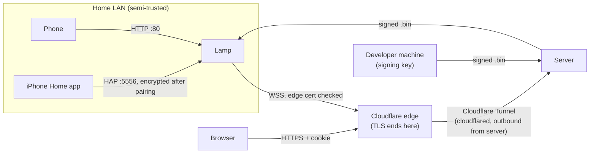

# 07: Security

Scope: a hobby project with a handful of trusted users. The aim is reasonable protection at low cost. The most important rule is that **nobody but the firmware signer can run code on a lamp**, because a lamp is a computer sitting on your home network.

## 1. Assets

| Asset | Impact if compromised |
|---|---|
| Ability to run code on a lamp (OTA, USB) | **High.** An attacker would hold a foothold on the home LAN and the WiFi password. |
| WiFi credentials stored on the lamps | Medium |
| The shared web password and sessions | Medium. Control of both lamps, the activity history and pushing *signed* firmware. There's one password, so anyone who has it can do everything. |
| Device tokens | Low–medium. Lets someone impersonate one lamp to the server. |
| Apple Home setup code and pairing keys | Low–medium. With the code, someone on the same LAN can pair an *unpaired* lamp. With an iPhone's pairing, they can control that lamp. |
| Lamp control (on/off/color) | Low. A nuisance. |

## 2. Trust boundaries

**Cloudflare is inside the trust boundary.** It terminates TLS at its edge, so it can see lamp ↔ server and browser ↔ server traffic in plaintext, including the shared password at login and device tokens. That's accepted for this project. Firmware stays safe even so: Cloudflare can't sign images (T2).

The signing key stays on the developer's machine. A **compromised server can't sign firmware**, so lamps refuse anything it hasn't been given by the signer.

## 3. Threats and mitigations

| # | Threat | Mitigation | What's left |
|---|---|---|---|
| T1 | Eavesdropping on or tampering with lamp ↔ server traffic | WSS to Cloudflare's edge with CA checking through the ESP-IDF certificate bundle, then the encrypted tunnel to the server. SNTP time is set before TLS so certificate dates can be checked. | Cloudflare itself can read the traffic (§2). Accepted. |
| T2 | A malicious or compromised server pushes firmware | Images are checked against the signing key (`SECURE_SIGNED_APPS_NO_SECURE_BOOT`). Images are also checked for project name, sha256 and downgrades. | None while the key stays secret |
| T3 | A stolen or leaked device token | Only the token's sha256 is stored server-side. It is per-device and can be revoked by unpairing or re-pairing. All it can do is pretend to be that lamp. | Limited to one lamp |
| T4 | Pairing codes guessed | 40-bit codes, 10-minute lifetime, single use, rate-limited (5/min/IP, 20/h overall) | Not feasible |
| T5 | The shared web password guessed by brute force | argon2id hash. 5 failed attempts per 15 minutes per IP and 30 per hour overall. `APP_PASSWORD` must be at least 12 characters. Failed logins are logged and shown in the activity log. | The overall limit lets an attacker lock out real logins for up to an hour. Accepted. |
| T6 | CSRF, or a WebSocket hijacked from another site | `SameSite=Lax` + `HttpOnly` + `Secure` cookies. Every request that changes something and every WS upgrade must carry an `Origin` equal to `PUBLIC_URL`. | |
| T7 | XSS in the web app | React escapes output by default. Strict CSP: `default-src 'self'` with no inline scripts in the server app. Device and scene names are treated as text only. | |
| T8 | Another device on the LAN controls the lamp | State control on the LAN has no password, like most LAN lights. Config, network, OTA and reset need the admin password. | Accepted: anyone on the LAN can change the light |
| T9 | A malicious website the user visits drives the lamp, through CSRF or DNS rebinding | See §4: `Host` check, JSON-only requests that change state, no CORS. Browsers' Private Network Access protections add another layer. | Small |
| T10 | Admin password sniffed on the LAN (plain HTTP) | Sessions are short. There's a rate limit. The UI warns that the password shouldn't be reused elsewhere. | **Accepted.** It protects against casual misuse, not an active attacker on your own LAN (§4). |
| T11 | Someone nearby joins the open setup AP during setup | The setup AP exists only while the lamp is unconfigured or after a deliberate trigger: holding the button or rapid power cycles. Setup routes stop working once setup finishes. The fallback AP is WPA2. | Accepted, as with most smart plugs |
| T12 | Physical access: reading flash over USB | Optional hardening (§8) | Accepted by default |
| T13 | Overload of the server or a lamp | Cloudflare absorbs floods before they reach the home connection. Size limits on messages, rate limits per connection, one socket per device, at most 3 local WS clients and 4 HomeKit sockets. | |
| T14 | Someone on the LAN pairs the lamp with their own Apple Home | Pairing needs the 8-digit setup code. It's random per lamp and only served to an admin session ([03 §11](03-firmware.md#11-apple-home-homekit)). HAP accepts a new pairing only while the lamp has none, and limits failed attempts. | Someone who saw the code can pair before the owner does. Reset Apple Home fixes it. |
| T15 | Eavesdropping on or tampering with Apple Home traffic | After pairing, HAP sessions are authenticated (Ed25519) and encrypted (ChaCha20-Poly1305). This is stronger than the local HTTP API. | None in practice |
| T16 | A development build that accepts plain `ws://` ends up on a lamp in daily use | `LAMP_ALLOW_INSECURE_SERVER` is off by default. Release CI fails if it's on. Even when on, it only allows private addresses. Lamps report `insecure_server_allowed`, and the web app shows a "dev build" badge. | Small: a person would have to flash it over USB |
| T17 | One shared password means no record of which person did what | Session labels ("Kitchen iPad") in the activity log. Each browser's session can be revoked on its own. | Accepted (A6). Labels are self-chosen, not proof of identity. |
| T18 | Spoofed `CF-Connecting-IP` to dodge login rate limits | The server's port isn't published. Only `cloudflared` can reach it, so every request really came through Cloudflare, which sets the header. | |
| T19 | The tunnel token leaks | Whoever holds it can run a connector for the tunnel and receive some of its traffic. Keep it in `.env` (never committed), and rotate it in the Cloudflare dashboard if exposed. | |

## 4. Lamp local API

The local UI runs over plain HTTP because browsers won't trust a self-signed certificate from a lamp. These measures limit what a malicious web page or a nosy LAN neighbor can do:

1. **`Host` header allow-list.** Requests must name the lamp's IP, `doublelamp-xxxxxx.local`, or `192.168.4.1`. Anything else gets `421`. This defeats DNS rebinding, where a malicious site's domain is pointed at the lamp's IP.
2. **Requests that change state must be `Content-Type: application/json`, and no CORS headers are ever sent.** A browser will only send such a request from another site after a CORS preflight, which the lamp never approves. Simple HTML form posts get `415`.
3. **The admin token goes in the `Authorization` header, never in a cookie.** A browser never adds it on its own, so other sites can't trigger admin actions (CSRF).
4. **Login hardening.** At most 5 attempts per minute. The password is stored as PBKDF2-SHA256 with a salt and 10 k iterations. Sessions live in RAM only and are cleared by a reboot.
5. **Setup-only routes** (`/setup`, unauthenticated `/wifi/scan`, unauthenticated `/cloud/claim`) answer `403` outside Setup mode.
6. **WebSocket upgrades** check `Host` and `Origin` the same way.

> **Why not encrypt the password exchange?** On plain HTTP, `crypto.subtle` isn't available, and hand-rolled challenge-response would add code without stopping an attacker who can change the page in transit. The risk is accepted and written down (T10).

## 5. Server hardening checklist

- [ ] Run as a non-root user in the container, with a read-only root filesystem and only `/data` writable.
- [ ] Cloudflare terminates TLS. Always Use HTTPS and HSTS are on, and the server also sends `Strict-Transport-Security`.
- [ ] No ports are forwarded on the router, and the server's port isn't published. Only `cloudflared` reaches it ([05 §13](05-server.md#13-deployment)).
- [ ] The Cloudflare settings in [05 §13](05-server.md#13-deployment) are applied, especially Bot Fight Mode off and the skip rule limited to the lamp paths.
- [ ] `SERVER_SECRET` and `APP_PASSWORD` come from the environment and are never committed. Remove `APP_PASSWORD` from the environment after the first start. Rotating `SERVER_SECRET` logs everyone out and expires download links, which is safe.
- [ ] Every request and message is validated with zod. Unknown `type`s and fields that are too large are rejected.
- [ ] Sessions use a 256-bit random token (only its hash is stored), expire after 30 days, rotate on login, and can be revoked in Settings. Changing the password revokes all other sessions.
- [ ] The server never logs tokens, passwords or pairing codes. pino redact paths enforce this.
- [ ] One shared login with no roles ([05 §6](05-server.md#6-login-one-shared-password)). Any session can upload firmware, start OTA and unpair, so treat the password like an admin password.
- [ ] Production never runs with `DEV_INSECURE`.

## 6. Firmware supply chain

- **The signing key** (RSA-3072, Secure Boot V2 format) is generated once with `espsecure.py generate_signing_key`.
  - It's kept offline, either on the developer's machine or as an encrypted CI secret.
  - Losing it means no more OTA updates; the lamps would have to be reflashed over USB.
- **CI builds** are reproducible from a pinned IDF container. `tools/sign-firmware` signs the image, then uploads it to the server. It asks for the shared password and doesn't store it.
- **Manual approval.** Uploading never triggers an update. A person always starts the OTA, and "Update both" updates the lamps one after the other.

## 7. Secrets inventory

| Secret | Where it lives | How it rotates |
|---|---|---|
| WiFi password | Lamp NVS | Re-run WiFi setup |
| Admin password (lamp) | Lamp NVS as a salted PBKDF2 hash | Device UI → Security |
| Direct-mode password | Lamp NVS as plaintext (the WiFi driver needs it) | Device UI → Security |
| Device token | Lamp NVS in plaintext; server stores sha256 | Re-pair |
| Apple Home setup code | Lamp NVS in plaintext, so the device UI can show it | Factory reset generates a new one |
| Apple Home pairing keys | Lamp NVS, in the HomeKit SDK's keystore | Device UI → Apple Home → Reset |
| Shared web password | Server, as an argon2id hash | Web app → Settings |
| `SERVER_SECRET` | Server environment | Redeploy |
| `TUNNEL_TOKEN` (Cloudflare Tunnel) | Server `.env` | Rotate in the Cloudflare dashboard, then redeploy |
| Firmware signing key | Offline or CI secret | Can't rotate without a USB reflash, so guard it |

## 8. Optional hardening (only for lamps that are "done")

| Measure | Protects against | Cost and warning |
|---|---|---|
| **Flash encryption** (release mode) | Reading WiFi credentials, tokens and Apple Home keys off a stolen lamp | One-way eFuse change. USB reflashing becomes limited. Test on a spare board first. |
| **NVS encryption** (HMAC-based scheme on the C3) | The same, for NVS only | Uses an eFuse key block. Needs flash encryption to protect the app too. |
| **Secure Boot V2** | Running unsigned code even with physical access | Irreversible. A lost key bricks USB recovery. Not recommended for a hobby build. |
| Disable USB-JTAG | Debug access | Lose easy debugging |

## 9. Privacy

- **What's stored:** state changes with where they came from and the session label, connects and disconnects, and the last telemetry values. Event logs are deleted after 30 days, and there are no third-party analytics.
- **What lamps send:** only what the protocol defines. They never send WiFi scan results, the Apple Home setup code or Apple Home pairing details to the server. They send only "paired or not" and a count.
- **Apple Home data stays local.** HAP runs between the iPhone and the lamp. Apple's servers are involved only through the user's own Home setup, for example iCloud syncing of the home.
- **Removal:** unpairing a lamp deletes its token. Revoking a session logs that browser out; past events keep its label.
