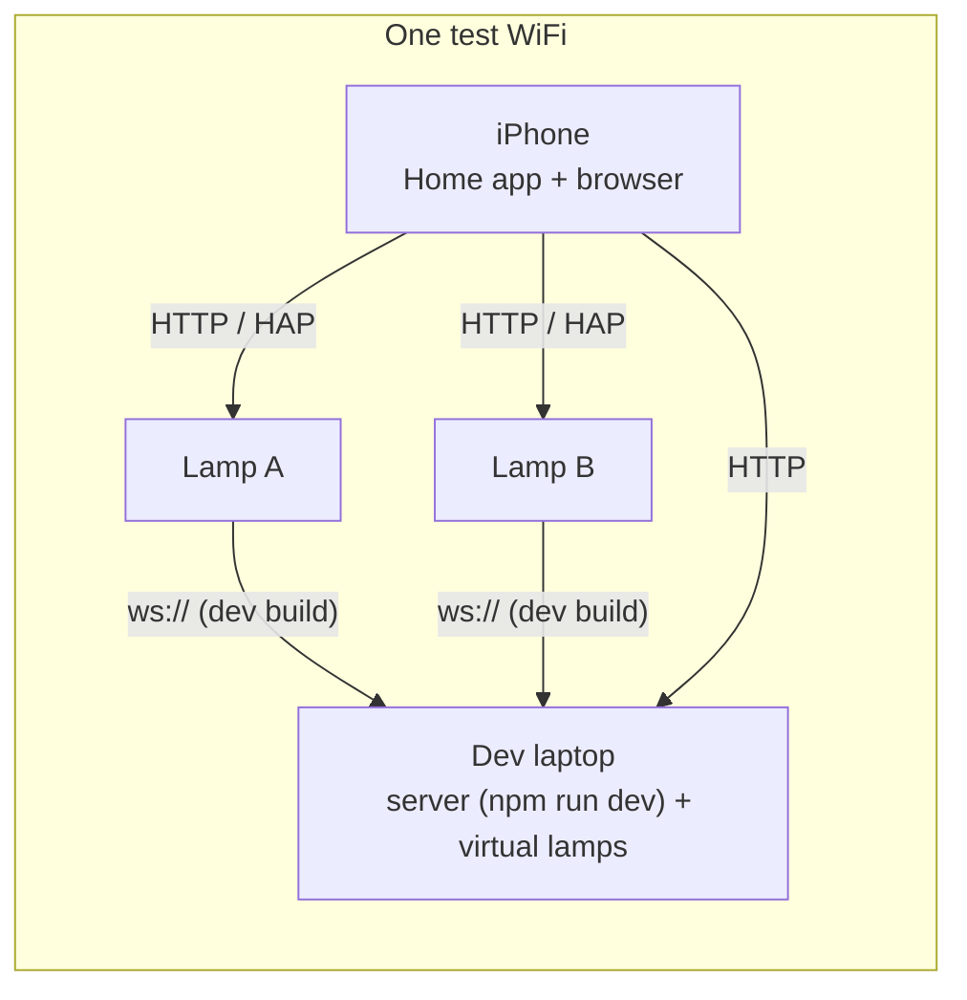

# 08: Testing and Roadmap

## Part 1: Testing

### 1.1 Test layers

| Layer | What it covers | Tooling | Runs |
|---|---|---|---|
| Firmware host unit tests | `lamp_core` (patch, clamp, dirty tracking, HomeKit ↔ state mapping), `effects` (golden frames, timing), protocol encode/decode, time-sync math, setup-code generation (rejects trivial codes) | CMake + Unity (or GoogleTest) on Linux/macOS/Windows | every push |
| Shared vectors | Messages, merge cases, effect frames ([04 §9](04-protocol.md#9-test-vectors)) | The same JSON files are loaded by the C++ and TypeScript tests | every push |
| Server unit tests | Sync engine, apply_at, scheduler next-run (including DST), pairing, OTA tokens | Vitest | every push |
| Server integration tests | Real Fastify + SQLite + two **virtual lamps** over real WebSockets | Vitest + `tools/virtual-lamp` | every push |
| Web E2E | Shared-password login and session revoke, link/unlink, color change shown on both virtual lamps, offline lamp error, scenes | Playwright | every push |
| Firmware target build | Compiles for esp32c3; image size and UI size checked against budgets | `espressif/idf` container | every push |
| Hardware in the loop | Real lamps on a bench, on one WiFi (§1.4) | Manual checklist (§1.6) | every release |
| Soak | 72 h with random commands and induced faults | Script + both real lamps | before 1.0, and after big changes |

### 1.2 Golden vectors keep three implementations identical

The firmware C++, the TypeScript port and the virtual lamp must all produce the same pixels. `tools/gen-vectors` holds a set of `(effect, params, t, n)` cases that cover the following:

- every effect;
- edge values (speed 0/255, n = 1, n = 1024), plus n = 10, the real lamps;
- time near wraparound;
- a range of seeds.

**The firmware C++ is the reference.** A host binary renders each case and writes the expected `#RRGGBB` arrays to `test-vectors/effects/*.json`. The TypeScript tests must match those arrays **exactly**.

When an effect changes on purpose, regenerate the vectors and review the diff in the PR.

### 1.3 Virtual lamp

`tools/virtual-lamp` is a Node program. It implements the lamp side of the protocol on top of `packages/effects`:

- pairing, `hello`/`welcome` and dirty tracking;
- time sync and `apply_at`;
- OTA progress, simulated;
- a `--report-origin homekit` switch, so local changes are reported the way a real lamp reports Apple Home changes. HAP itself isn't simulated, because the server never sees it.

It renders the strip to the terminal (truecolor blocks) or to a small local web page. It also has fault switches: `--latency 200`, `--jitter 50`, `--drop 0.05`, `--offline-after 30s`, `--crash-on-ota`.

This lets the server and web app be built and tested in CI without hardware, and two virtual lamps side by side show sync bugs right away.

### 1.4 Test bed: everything on one WiFi

In production the lamps are in two homes and the server is on a third network. For day-to-day testing, everything sits on **one WiFi network** instead:

- **Server.** Local dev mode or staging mode ([05 §13](05-server.md#13-deployment)). Local dev uses development firmware that accepts `ws://` to private addresses. Staging uses release firmware and a staging hostname on the Cloudflare Tunnel, so lamp traffic goes out to Cloudflare and back even though everything shares one WiFi.
- **Apple Home.** Add both lamps to one test home on the iPhone. With the lamps linked, changing lamp A in the Home app should move lamp B too, and the Home app should show both changes.
- **Sync measurement.** Both lamps fit in one camera frame (§1.7).
- **What it doesn't cover.** One network has almost no delay or asymmetry, so it hides problems that appear between two homes. Before each release, also run:
  - two virtual lamps with `--latency 120 --jitter 40` linked to one real lamp;
  - one real lamp on a phone hotspot (cellular uplink) and the other on the WiFi, with the server in staging mode.

### 1.5 Key scenarios (integration and E2E)

1. **Linked change.** A command to the group reaches both lamps with the same `apply_at` and the same `effect.epoch`.
2. **Concurrent edits.** Lamp A sends a local brightness change while the web sends a color change to the group. Both lamps end with both changes.
3. **Race on one field.** Lamp A sets red locally while the web sets blue at nearly the same moment. Every lamp and browser ends on whichever change the server received last.
4. **Offline edit wins.** Lamp A goes offline, gets a local edit, and reconnects 5 min later. The edit spreads to lamp B because no newer server change exists.
5. **Offline edit loses.** The same, but the web changed the group after A's edit. A gets the server's value.
6. **Unknown age.** Lamp A reboots while offline and its restored state has no age. The server's value wins when it reconnects.
7. **Link direction.** "Match B to A" when linking: B blends to A's look at the shared `apply_at`.
8. **Command to an offline lamp.** Fails with `offline`, nothing is queued, and the toast appears.
9. **OTA failure.** A virtual lamp with `--crash-on-ota` reports `rollback: true`. The job is marked failed and "Update both" doesn't go on to the second lamp.
10. **Missed schedules.** A run less than 5 min late fires at startup; one more than 5 min late is skipped and logged.
11. **Apple Home change while linked.** A virtual lamp started with `--report-origin homekit` changes color. The partner follows at a shared `apply_at`, and the activity log shows "Apple Home" as the source.
12. **Password change.** Changing the shared password revokes every other session. Their WebSockets close, and those browsers return to the login screen.

### 1.6 Hardware-in-the-loop checklist (each release)

The bring-up steps are in [02 §7](02-hardware.md#7-bring-up-checklist). Then check:

- [ ] Run setup from scratch on an iPhone and an Android phone through the captive portal.
- [ ] LAN command latency: p95 ≤ 150 ms, timed from the local UI log against a slow-motion video.
- [ ] Through Cloudflare: leave a lamp idle (no commands) for 30 min. Telemetry shows no reconnects, which proves the 20 s `time.ping` heartbeat beats Cloudflare's 100 s idle timeout. Pairing and an OTA download also work through Cloudflare with no challenge pages (check Security → Events in the dashboard).
- [ ] Unplug the router for 5 min. The lamp keeps its state, enters Fallback after 2 min, is controllable over its AP, and returns to Online on its own.
- [ ] Block the internet but keep the LAN. Local control is unaffected, and the web app shows the lamp as offline.
- [ ] Power-cycle 20 times. No boot flash, and the light is restored within 500 ms.
- [ ] Do 5 rapid power cycles; Setup mode starts. Hold 10 s; factory reset starts, and letting go early cancels it.
- [ ] OTA from the server and by local upload. A deliberately broken build rolls back automatically.
- [ ] Free heap stays ≥ 40 KB during TLS + 3 local WS clients + 2 HomeKit sessions + OTA (from telemetry).
- [ ] The current limiter keeps measured current under `max_current_ma` at full white.

**Apple Home** (an iPhone on the same WiFi, no home hub):
- [ ] Add the lamp with the code from the device UI. "Add Anyway" at the "Uncertified Accessory" prompt completes pairing. Rendering doesn't stutter during pairing.
- [ ] On/off, brightness and color from the Home app and from Siri. p95 ≤ 300 ms to the light changing.
- [ ] A color chosen while `rainbow` runs switches to `solid`. A color chosen while `breathe` runs keeps breathing in the new color.
- [ ] Changes from the web app, the button and the partner lamp show up in the Home app within a second.
- [ ] Pairing survives a reboot, an OTA update and a WiFi change.
- [ ] Reset Apple Home removes the lamp's pairings (the Home app shows "No Response" until it's removed there), and the lamp can be added again with the same code.
- [ ] Factory reset generates a new code, and the old code no longer works.
- [ ] A second iPhone in the same Apple Home controls the lamp through Home sharing.

### 1.7 Measuring sync between lamps

1. Link both lamps and select the `sync_test` effect, which flashes on each whole second of the sync clock.
2. Put both lamps in the frame of a phone filming 240 fps slow motion.
3. Count the frames between the two flashes. One frame is about 4.2 ms.

Targets: **effect phase skew ≤ 30 ms** (≈ 7 frames), and **change skew with `apply_at` ≤ 50 ms**.

To test across two homes, use a second phone and compare against a shared reference, for example both filming a screen showing a `time.is`-style clock. Or rely on the server's skew estimate: the difference between the two lamps' `offset` errors, reported in telemetry.

### 1.8 Soak and fault injection

Run 72 h with both real lamps plus 2 virtual lamps. A script sends random commands at 0.2–5 Hz and adds faults:

- restart the server every 2 h;
- drop WiFi every 3 h;
- an OTA in the middle of the run.

**Pass criteria:**
- no lamp reboots except the planned OTA;
- `heap_min` doesn't drift downward;
- every reconnect converges within 5 s;
- no lamp's state differs from the server's for more than 2 s.

### 1.9 CI (GitHub Actions)

| Job | Steps |
|---|---|
| `ts` | npm ci → lint (eslint, tsc) → Vitest (protocol, effects, server, web) → build web + device UI → check size budgets → Playwright with 2 virtual lamps |
| `firmware` | Build the device UI → `idf.py build` in a pinned `espressif/idf` container, HomeKit SDK submodule included → check app size ≤ 1.6 MB → host unit tests → check that committed vectors and UI bundle are current |
| `release` (on a tag) | Fail if `LAMP_ALLOW_INSECURE_SERVER=y` → build the firmware → sign it (protected secret, manual approval) → attach to the GitHub release → optional upload to the server. Build and push the server Docker image. |

## Part 2: Roadmap

Each milestone ends with something usable.

| Milestone | Scope | Done when |
|---|---|---|
| **M0 Bring-up** | Wiring per [02](02-hardware.md) (12 V strip, 74AHCT125, buck); ESP-IDF project; led_strip SPI-DMA on GPIO7; test patterns; current limiter. **Footprint spike:** one throwaway build that links the HomeKit SDK (a bare Lightbulb accessory), `esp_http_server`, `esp_websocket_client` with TLS and OTA. | The strip shows correct colors at 100 fps with WiFi busy; [02 §7](02-hardware.md#7-bring-up-checklist) passes. The spike's image size and free heap with an iPhone paired and a TLS connection open are recorded and fit the budgets in [03 §18](03-firmware.md#18-resource-budget-acceptance-targets), or the fixes in [03 §15](03-firmware.md#15-ota-and-partitions) are chosen. |
| **M1 Standalone lamp** | State store, effects (solid, breathe, gradient, rainbow, candle), NVS persistence and restore, Setup AP + captive portal, local REST + WS, device UI, mDNS, button | A new lamp can be set up from a phone and used daily with no server. Host tests pass. |
| **M2 Apple Home** | `homekit` component: Lightbulb accessory, state mapping, setup code, device UI Apple Home screens, Reset Apple Home | The lamp can be added to Apple Home with no hub and controlled from the Home app and Siri on the same WiFi. The Apple Home checks in §1.6 pass. |
| **M3 Server MVP** | Server skeleton, shared-password login, pairing, device hub, web app Home + Lamp screens for individual control, virtual lamp, local dev mode on one WiFi | Both lamps can be controlled through the web app, first on the test WiFi (§1.4), then from anywhere through the public server |
| **M4 Linked sync** | Groups, link/unlink, time sync, `apply_at`, effect epochs, reconnect merge, previews in the browser | Sync measurements meet the targets (§1.7). The scenarios in §1.5 pass, including on the two-network setup in §1.4. |
| **M5 Operate** | Signed OTA with rollback, firmware library, scenes → presets, schedules (sunrise), activity log, telemetry | A firmware release goes out with no USB. The soak test (§1.8) passes. |
| **M6 Delight (stretch)** | **Nudge** (double-press sends a pulse to the partner lamp); **span mode** (the two strips act as one long virtual strip); on-device schedules; Apple Home color temperature; WPA2-Enterprise; flashing new lamps from the web app (ESP Web Tools + Improv); a Home Assistant integration (MQTT bridge) | Pick one at a time |

**M0 spike result (compile-time, 2026-10-28):** with ESP-IDF v5.5.6 and esp-homekit-sdk 676fabac the full firmware (HomeKit + TLS WebSocket client + HTTP server + OTA) is 1.32 MB, and static RAM is 141 KB of 321 KB. The heap numbers under load still need a real lamp: watch the `heap:` log lines during bring-up ([09](09-bring-up.md)).

M2 and M3 don't depend on each other. Swap them if linking matters more than Apple Home early on. The M0 spike already retires Apple Home's main risk, flash and heap.

## Part 3: Risks

| Risk | Likelihood | Impact | Mitigation |
|---|---|---|---|
| 3.3 V data line is unreliable | High without a shifter | Med | A 74AHCT125 is in the BOM |
| The level shifter on hand is a BSS138 bidirectional board, which is too slow for 800 kHz | Med | Med | Warning in [02 §4](02-hardware.md#4-wiring). The glitch test catches it. The 74AHCT125 in the BOM is the fix. |
| Adjustable buck left at the wrong voltage destroys a XIAO | Low | Med | Set and measure before connecting ([02 §7](02-hardware.md#7-bring-up-checklist), step 2), or use a fixed 5 V module |
| WiFi interrupts glitch the LED output | Med with RMT | Med | SPI-DMA backend. Glitch test in bring-up. |
| Campus WiFi (WPA2-Enterprise, or devices blocked from each other) | Med | Med | The server path works even when LAN access is blocked. Fallback AP. Enterprise support is a stretch goal. Apple Home won't work on such networks. |
| Not enough heap or flash with TLS + HTTP + WS + HomeKit on the C3 | Med | High | Measured in the M0 spike before building on it. HomeKit capped at 4 sockets. Budgets enforced in telemetry and soak tests. At most 3 local WS clients. Fixed buffers. |
| Apple changes how iOS treats uncertified HAP accessories | Low | Med | The local UI and the web app don't depend on Apple Home. Matter is the fallback, but it would need a home hub ([ADR-0004](adr/0004-apple-home-via-hap.md)). |
| The HomeKit SDK falls behind new ESP-IDF releases | Med | Low | Pin IDF and the SDK together, and upgrade them together on purpose |
| Effects differ between C++ and TypeScript | Med | Low | Golden vectors are checked in CI |
| Signing key lost | Low | High | Back it up, encrypted, in two places. USB reflash is the recovery path. |
| Server down, so schedules don't run | Med | Low | Documented. On-device schedules in M6. Apple Home automations would need a home hub, which isn't planned. |
| A dev build that allows `ws://` ends up on a lamp in daily use | Low | Med | Release CI check, "dev build" badge in the web app ([07](07-security.md) T16) |
| A Cloudflare security feature (Bot Fight Mode, challenges) blocks the lamps, which can't solve challenges | Med | High | Settings in [05 §13](05-server.md#13-deployment): Bot Fight Mode off, a skip rule for lamp paths, `User-Agent: DoubleLamp/<fw>`. Checked in the HIL list (§1.6). |
| The local server machine sleeps, reboots or loses power | Med | Med | Lamps keep working locally and catch up on reconnect. Disable sleep, use `restart: unless-stopped`, and watch `/healthz` from outside (for example a free uptime monitor). |
| Only 10 pixels per lamp makes spatial effects look blocky | High | Low | Defaults tuned for 10 pixels ([03 §6](03-firmware.md#6-effects)). Whole-lamp effects are the default choices. |
